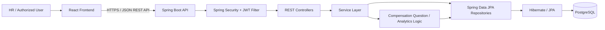
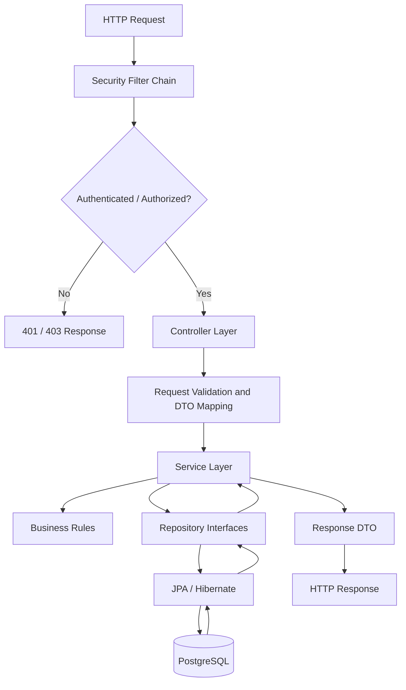
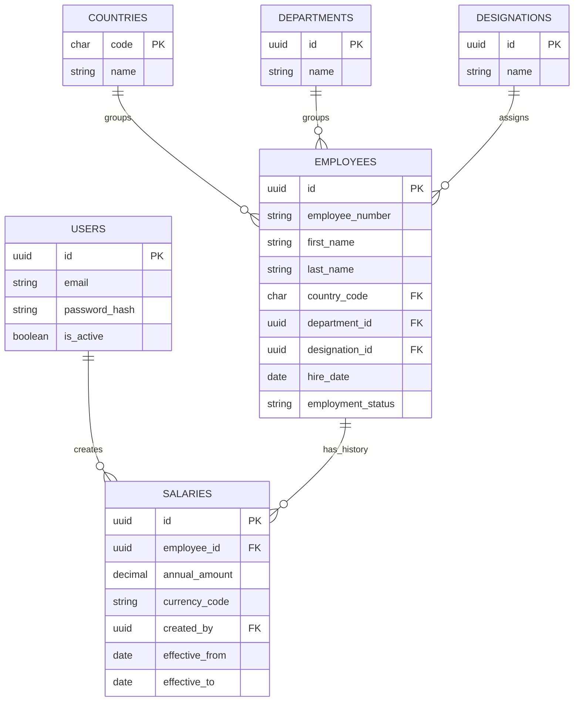

# ACME Salary Management System — Engineering Artifacts

**Purpose:** Document the architecture, AI-assisted development workflow, key trade-offs, and performance considerations for the salary-management assessment.

> **Scope note:** This document complements the existing requirements and backend-architecture documents. The diagrams and decisions below describe the intended design of the submitted Spring Boot, React, and PostgreSQL application. Before submission, verify that each point matches the final code and deployment configuration. The AI prompts are representative prompts for documenting the workflow; retain only prompts that reflect the work actually performed.

---

## 1. Architecture diagrams 

### 1.1 System context and request flow

**Request lifecycle**

1. The user interacts with the React application.
2. The frontend calls the backend REST API and supplies a bearer token for protected requests.
3. Spring Security validates the token and establishes the authenticated security context.
4. Controllers validate request shape and delegate business operations to services.
5. Services apply business rules and call repositories.
6. Spring Data JPA/Hibernate executes database operations against PostgreSQL.
7. The API returns a structured response to the frontend.

The browser should communicate with the backend over HTTPS in a deployed environment. Credentials and signing keys belong in environment-based configuration or a secret manager, not in source control.

### 1.2 Backend component architecture

**Layer responsibilities**

- **Security:** Authenticate requests, validate JWTs, and enforce route/role permissions.
- **Controllers:** Define HTTP contracts, parse input, and select status codes.
- **DTOs and validation:** Keep API payloads separate from persistence entities and reject invalid input early.
- **Services:** Own business rules, transaction boundaries, and cross-entity operations.
- **Repositories:** Encapsulate data access and database queries.
- **PostgreSQL:** Persist users, employees, salary history, and supporting reference data.

### 1.3 Core data relationships

A salary record is effective for the date range from `effective_from` through `effective_to`; a null `effective_to` represents an open-ended period if that is the convention used by the implementation. Queries for a current salary should apply the same date-boundary rule consistently. Foreign keys protect referential integrity; deletion behavior should be explicit where salary history exists.

---

## 2. Prompts and instructions used with AI tools

AI assistance is most useful when treated as a collaborator for drafting, reviewing, and debugging—not as an unquestioned source of truth. The developer remains responsible for validating generated code against the assessment requirements, compiling and testing it, reviewing security implications, and understanding the final implementation.

The following are **representative prompts** that can be included in the development record if they accurately reflect the prompts used. They are not asserted to be a verbatim log of past conversations.

### 2.1 Requirements and scope

> Review the salary-management assessment requirements and produce a concise requirements document. Separate functional requirements, non-functional requirements, assumptions, out-of-scope items, and acceptance criteria. The system must manage employee records and effective-dated salary information for approximately 10,000 employees across multiple countries. Identify ambiguities rather than inventing requirements.

### 2.2 Data model and API design

> Propose a normalized PostgreSQL schema for users, employees, salaries, countries, departments, and designations. Use UUID identifiers where appropriate, foreign keys, constraints, and effective dates for salary history. Explain how to represent current salary and prevent invalid or overlapping salary periods. Then propose REST endpoints with request/response DTOs, validation, pagination, filtering, and error responses.

### 2.3 Backend implementation

> Implement the requested endpoint in the existing Spring Boot project using its current package structure and conventions. Keep HTTP handling in the controller, business logic in the service, and persistence in the repository. Use DTOs rather than exposing JPA entities directly, apply validation and transactions where needed, and include appropriate error handling. Explain any assumptions and list tests that should be run.

### 2.4 Authentication and authorization

> Review the Spring Security and JWT flow. Check that public authentication endpoints are explicitly permitted, protected endpoints require a valid token, signing keys meet the algorithm's minimum security requirements, passwords are hashed, and CORS permits only the intended frontend origins. Do not place secrets in source code. Identify security gaps and propose focused fixes.

### 2.5 Debugging and query review

> Diagnose this error using the supplied stack trace, entity mappings, repository query, and database schema. Identify the most likely root cause, explain why it occurs, and propose the smallest safe fix. Do not assume a column or property exists unless it appears in the supplied code/schema. Include a regression test or SQL check to verify the fix.

### 2.6 Performance review

> Review the employee and salary list/search/analytics endpoints for a dataset of about 10,000 employees. Look for unbounded queries, N+1 selects, missing indexes, inefficient joins, repeated database calls, and incorrect pagination. Recommend measurable improvements and explain how to validate them with query plans, representative data, and endpoint timing.

### 2.7 Review discipline

For each AI-generated suggestion:

1. Compare it with the actual entity mappings, schema, and API contract.
2. Check framework-version compatibility and compile the code.
3. Test normal, invalid, unauthorized, not-found, and boundary-date cases.
4. Inspect SQL behavior and transaction boundaries for data-changing operations.
5. Remove hard-coded credentials, sample secrets, and unsupported claims.
6. Keep only code that is understood and can be explained during review.

**Privacy note:** Do not submit real employee salary data, credentials, access tokens, production connection strings, or other confidential information to AI tools. Use synthetic examples and redact secrets from logs.

---

## 3. Trade-off explanations

### 3.1 Layered monolith instead of microservices

**Decision:** Keep the backend as a single Spring Boot application with clear controller, service, and repository boundaries.

**Why:** The assessment has a defined scope and a dataset of roughly 10,000 employees. A layered monolith is easier to build, run, debug, test, and deploy than multiple independently deployed services. It avoids service-to-service networking, distributed tracing, deployment coordination, and distributed transaction complexity.

**Cost / limitation:** All backend modules share a deployment and runtime. If traffic or team ownership grows substantially, individual modules may eventually need clearer boundaries or independent scaling.

### 3.2 PostgreSQL and relational integrity

**Decision:** Use PostgreSQL with normalized reference tables and foreign-key relationships.

**Why:** Employee, country, department, designation, user, and salary records are relational data. Constraints and transactions help prevent invalid references and inconsistent updates. SQL also supports reporting and aggregation.

**Cost / limitation:** Joins and indexes need to be designed around actual query patterns. Schema changes should be managed carefully, ideally through versioned migrations rather than relying on implicit production schema updates.

### 3.3 Effective-dated salary history

**Decision:** Represent salary changes as records with effective start and end dates instead of overwriting the only salary value.

**Why:** This preserves historical compensation and allows the application to answer “what was the salary on a given date?” as well as “what is the current salary?”

**Cost / limitation:** Every query that determines the current salary must apply the date rules consistently. The data model and write path should also prevent unintended overlapping effective periods for the same employee. If overlap prevention is required, enforce it transactionally and consider a PostgreSQL exclusion constraint where the schema and deployment support it.

### 3.4 UUID identifiers

**Decision:** Use UUID identifiers for core records where appropriate.

**Why:** UUIDs reduce dependence on predictable sequential IDs and make identifiers easier to generate across application components.

**Cost / limitation:** UUIDs are larger than integer keys and can be less cache-friendly in indexes. Use consistent UUID types and mappings throughout Java entities, repository methods, SQL columns, and API paths.

### 3.5 JWT-based stateless authentication

**Decision:** Use bearer tokens and stateless request authentication for protected APIs.

**Why:** The backend does not need to maintain a server-side HTTP session for every authenticated request, which simplifies deployment and horizontal scaling.

**Cost / limitation:** Token expiry, signing-key management, revocation, and role/permission changes require deliberate handling. Short-lived access tokens, secure key storage, and a documented refresh/re-authentication strategy are preferable to long-lived tokens. JWT payloads are not a place for secrets.

### 3.6 Query-time analytics instead of a separate analytics store

**Decision:** Start with SQL aggregations over PostgreSQL rather than introducing a separate data warehouse, search engine, or cache.

**Why:** For the assessment's approximate data volume, direct queries are simpler and keep results close to the source of truth. It avoids cache invalidation and synchronization work.

**Cost / limitation:** Complex or frequent analytics can compete with transactional queries as data and traffic grow. At that point, use measured evidence to decide whether to add materialized views, caching, read replicas, or asynchronous aggregation.

### 3.7 Pagination for list endpoints

**Decision:** Return employee and salary lists in pages instead of returning every row.

**Why:** Pagination limits response size, memory use, serialization work, and database transfer. It also makes UI tables easier to operate.

**Cost / limitation:** Offset pagination can become slower for very deep pages and results can shift while data changes. For this scale, conventional page/size pagination is reasonable; keyset pagination can be considered if deep-page latency becomes a measured problem. Always impose a maximum page size.

### 3.8 DTOs instead of returning persistence entities

**Decision:** Use API DTOs for request and response contracts.

**Why:** DTOs prevent accidental exposure of internal fields, reduce coupling between API clients and database structure, and allow joined display values such as employee full name, department name, or designation name to be returned cleanly.

**Cost / limitation:** DTO mapping adds code and projections must match their constructor/property types. Tests should cover query projections and serialization, especially UUID, decimal, and date/time types.

### 3.9 Referential integrity over unrestricted deletion

**Decision:** Preserve salary history and prevent employee deletion when it would orphan historical salary records, unless an explicit archival/deletion policy is defined.

**Why:** Compensation history has audit and reporting value. A database foreign key can protect this invariant even if a controller or service has a defect.

**Cost / limitation:** The UI must explain why deletion is blocked and offer a valid alternative, such as marking an employee inactive. Cascading deletion should not be enabled casually for historical payroll data.

---

## 4. Performance considerations

### 4.1 Expected workload and design target

The assessment describes approximately **10,000 employees**. That is a moderate relational dataset, but performance still depends on row counts in salary history, query shape, indexes, concurrent users, network latency, and hosting limits. No latency or throughput figure should be claimed without measurement.

### 4.2 Database and query practices

- **Indexes:** Evaluate indexes for employee search and common filters, such as `employee_number`, normalized/searchable name fields, country, department, designation, employment status, and salary lookups by `employee_id` and effective dates. Add indexes based on actual query predicates and `EXPLAIN (ANALYZE, BUFFERS)` results; unnecessary indexes slow writes and consume storage.
- **Foreign keys:** Ensure referenced columns are indexed where query patterns need them. PostgreSQL does not automatically create an index on every referencing foreign-key column.
- **Pagination:** Apply a stable sort order, such as a unique ID as a tie-breaker, and cap the requested page size.
- **Projection:** For list and analytics responses, select only required columns. Avoid loading entire entity graphs when the UI needs a few display fields.
- **N+1 queries:** Check whether accessing employee, department, designation, or salary relationships causes a query per row. Prefer a suitable join, projection, entity graph, or batch strategy for each use case.
- **Search:** Use parameterized queries. A leading-wildcard `LIKE '%term%'` may not use a conventional B-tree index efficiently; if name search becomes slow, evaluate PostgreSQL trigram indexes or full-text search using representative data.
- **Current salary:** Filter using the effective-date condition in the database. Confirm that `effective_from` and `effective_to` boundary semantics are consistent and that the query cannot return multiple “current” rows for one employee.
- **Analytics:** Aggregate in SQL where practical and group by currency/country when currencies differ. Do not sum amounts denominated in different currencies without an explicit conversion rule.
- **Transactions:** Keep transactions around coherent data changes. Avoid holding database transactions open while performing unrelated slow work.
- **Connection pool:** Configure the pool for the actual hosting/database limits and expected concurrency. Increasing the pool indiscriminately can overload PostgreSQL rather than improve throughput.

### 4.3 API and frontend practices

- Return only fields needed by the screen and avoid unnecessarily large JSON payloads.
- Debounce interactive search input to avoid issuing a request on every keystroke.
- Avoid duplicate frontend requests and unnecessary re-renders.
- Use loading, empty, validation, and error states so users can distinguish a slow response from a failed request.
- Configure CORS for the deployed frontend origin; CORS is a browser access policy, not a substitute for API authentication.
- Use HTTPS in deployment and avoid logging bearer tokens or sensitive salary values.

### 4.4 Security and correctness are performance requirements too

- Hash passwords with a suitable password-hashing algorithm; never store plaintext passwords.
- Keep JWT secrets and database credentials out of the repository.
- Validate pagination parameters and all externally supplied filters.
- Use parameterized repository queries to reduce injection risk.
- Protect salary-changing operations with the appropriate authorization checks and transactions.
- Use explicit date and currency semantics to avoid plausible-looking but incorrect analytics.

### 4.5 Validation and measurement plan

Performance should be demonstrated with repeatable tests rather than estimated from source code alone.

| Area | How to validate | What to record |
|---|---|---|
| Employee list | Request multiple pages using representative seeded data | p50/p95 response time, response size, SQL count |
| Employee search | Test common and worst-case search terms | Latency, query plan, index usage |
| Current salary | Compare result count and correctness at date boundaries | Query latency, rows scanned, duplicate-current-row checks |
| Analytics | Run each aggregation with realistic salary-history volume | Latency, execution plan, DB CPU/load |
| Concurrent access | Run a controlled load test with realistic read/write mix | Throughput, p95/p99 latency, error rate, pool wait |
| Data integrity | Test overlapping salary periods and referenced-employee deletion | Constraint behavior and transaction rollback |
| Security | Test missing, malformed, expired, and unauthorized tokens | Correct 401/403 behavior and no data leakage |

Suggested workflow:

1. Seed representative data, including multiple salary-history records per employee—not only one salary row each.
2. Run correctness tests before timing queries.
3. Capture query plans for slow or high-frequency database operations.
4. Establish a baseline with warm-up and repeated runs.
5. Change one bottleneck at a time and compare the same workload.
6. Document the environment and dataset size alongside every reported result.

**Measurement status:** This document defines a validation plan; it does not claim that benchmark tests have already been run or that a specific response-time target has been achieved.

---

## 5. Known limitations and future improvements

Potential next steps, depending on the final implementation and assessment scope:

- Add automated unit, repository, controller, and integration tests for salary effective-date rules and authorization.
- Use versioned database migrations and validate schema compatibility during deployment.
- Add structured logs, request correlation IDs, health checks, and basic metrics.
- Add audit events for salary changes, including who changed the salary and when.
- Add explicit validation or database enforcement for overlapping salary periods.
- Add rate limiting and abuse protection to authentication endpoints if exposed publicly.
- Consider caching or materialized views only after profiling demonstrates a need.
- Document currency conversion policy before adding cross-country salary comparisons.

---

## 6. Final review checklist

- [ ] Diagrams match the submitted source code and deployed topology.
- [ ] The effective-date convention for salary history is stated consistently.
- [ ] AI prompts retained here reflect the actual development process; untrue prompts have been removed.
- [ ] No credentials, access tokens, private employee records, or production URLs with secrets are included.
- [ ] Performance claims are supported by reproducible measurements.
- [ ] Tests cover authorization, invalid input, date boundaries, pagination, and foreign-key behavior.
- [ ] Existing requirements and architecture documents remain the source of truth for the complete assessment scope.
